# AI Web Apps — Streamlit & React

Bốn ứng dụng AI (phân loại ảnh, phát hiện đối tượng, tìm kiếm ảnh, chatbot RAG) sau một backend FastAPI,
với hai giao diện: Streamlit và React.

## Slide

Bản PDF: [docs/slides/slides.pdf](./docs/slides/slides.pdf) · Mã nguồn slide: `docs/slides/src/` ·

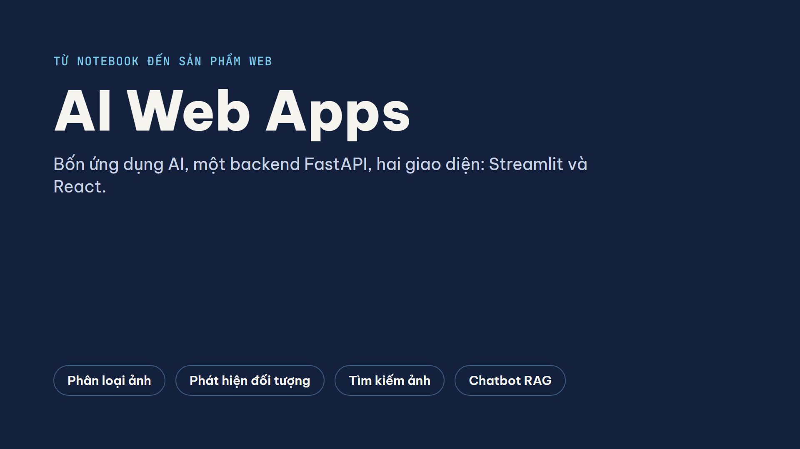

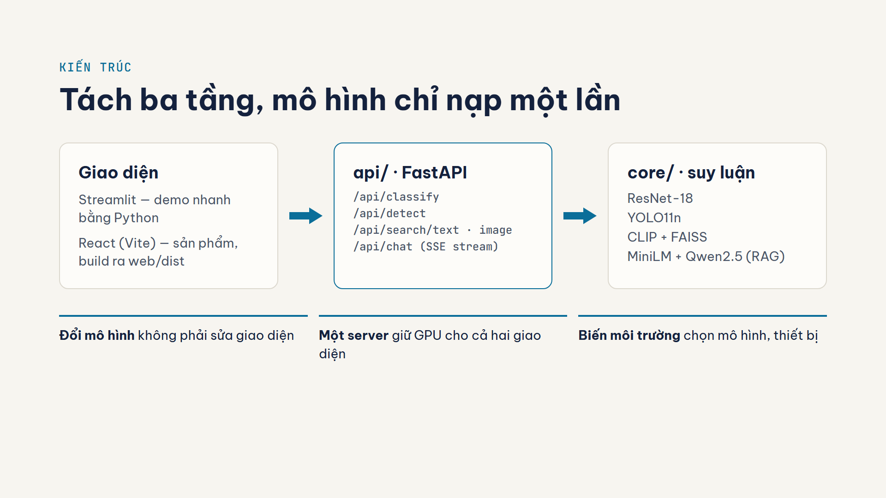

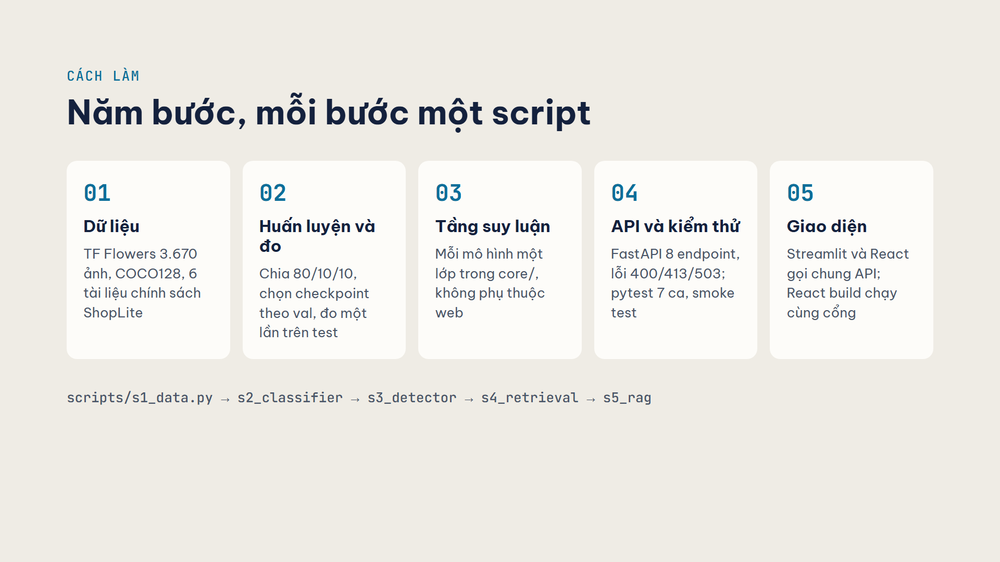

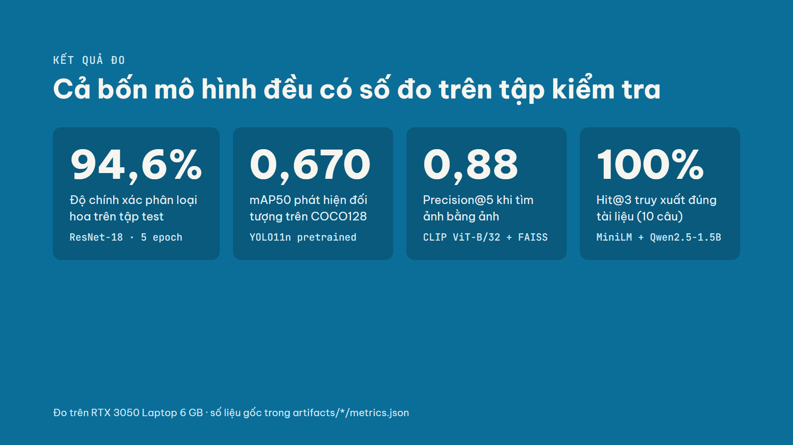

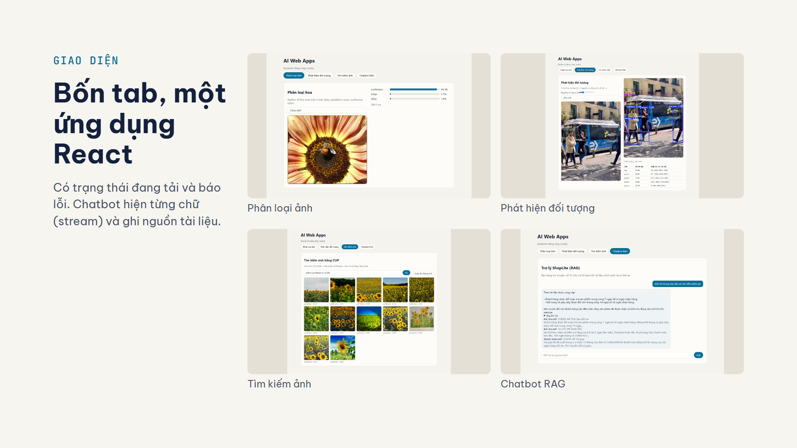

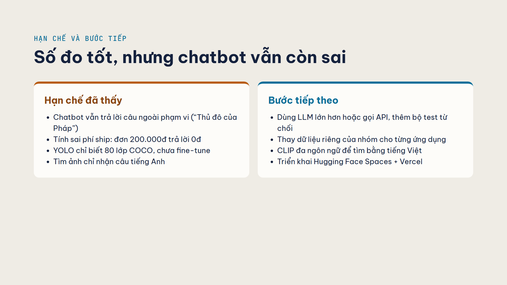

## Giao diện

Cả hai giao diện gọi chung một backend FastAPI.

### React — Phân loại ảnh
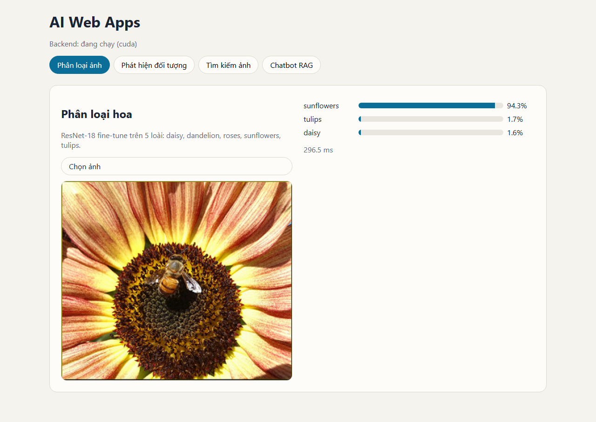

### React — Phát hiện đối tượng
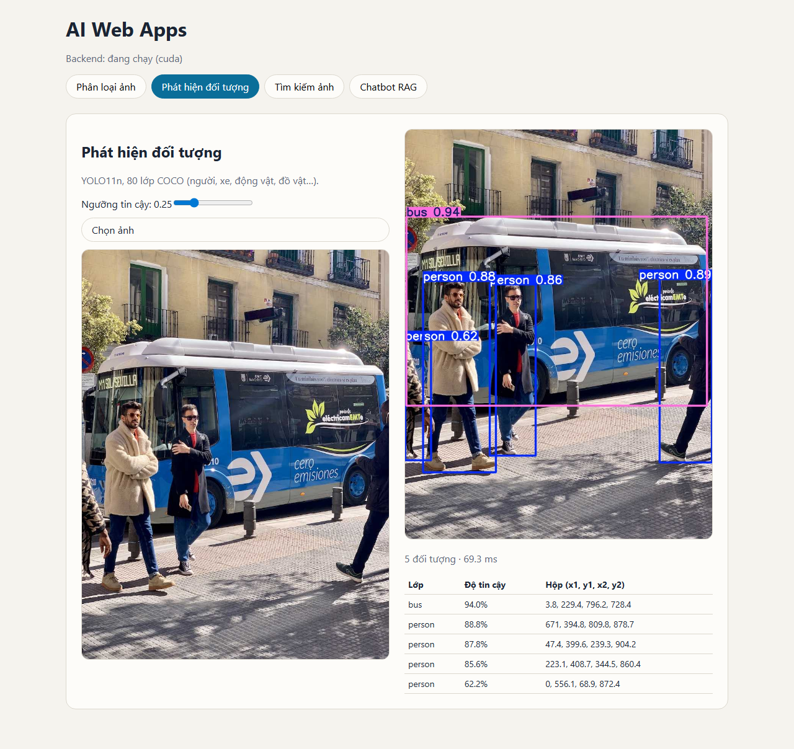

### React — Tìm kiếm ảnh
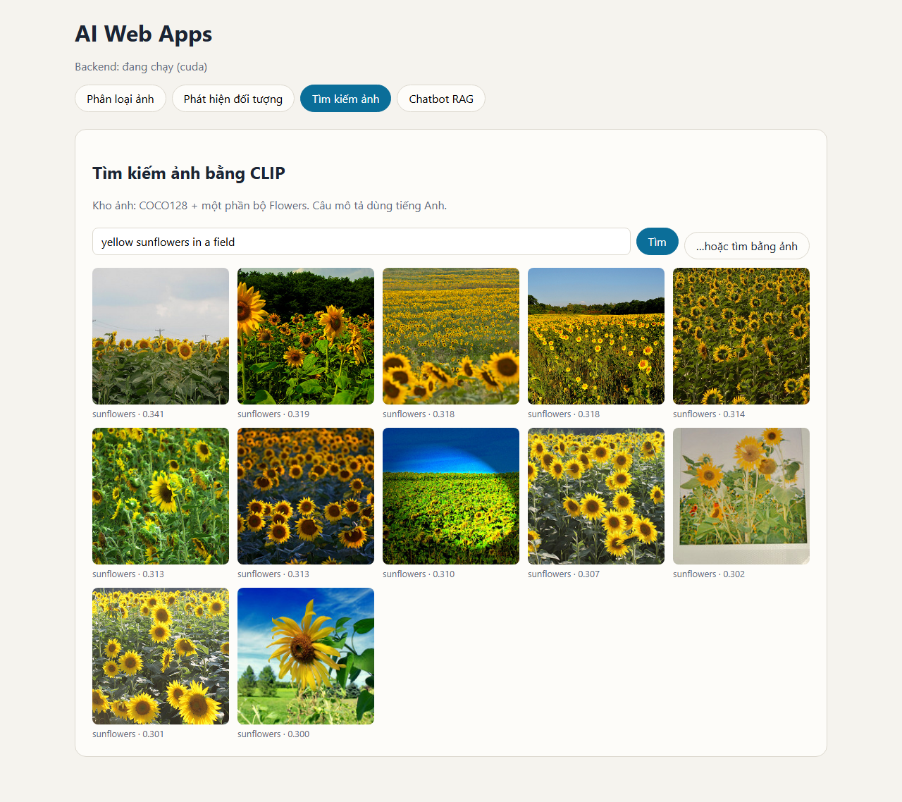

### React — Chatbot RAG
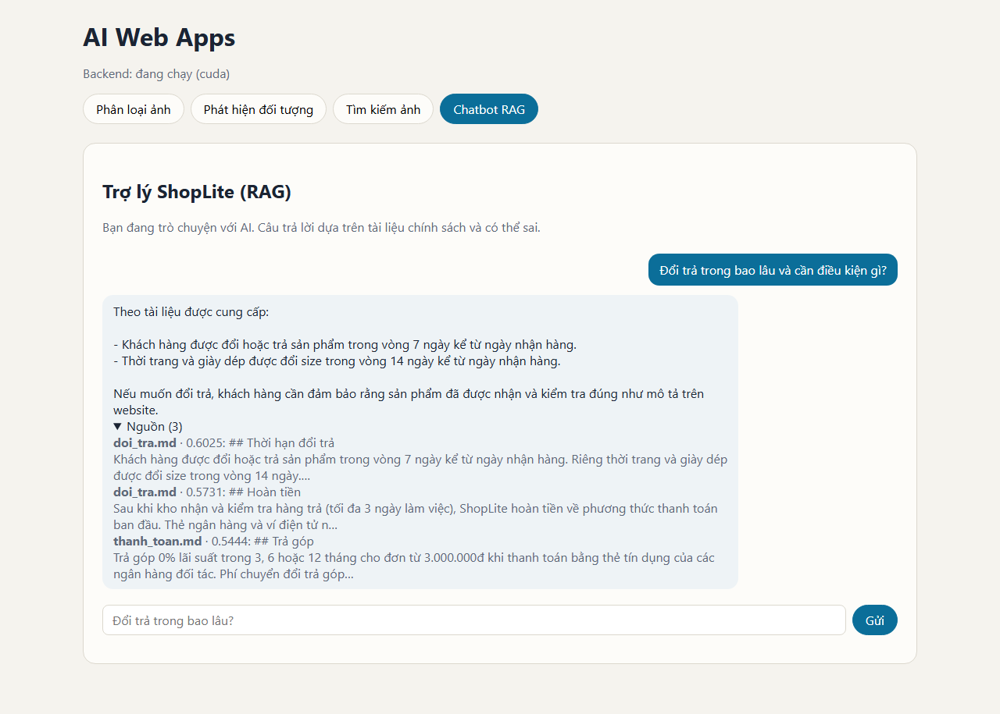

### Streamlit — Phân loại ảnh
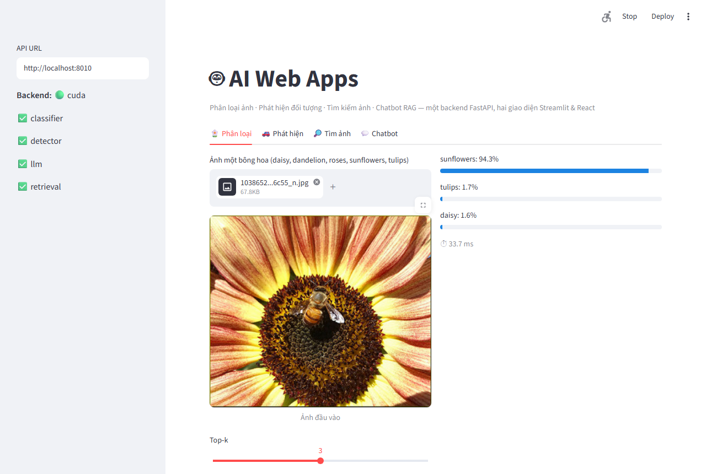

### Streamlit — Chatbot
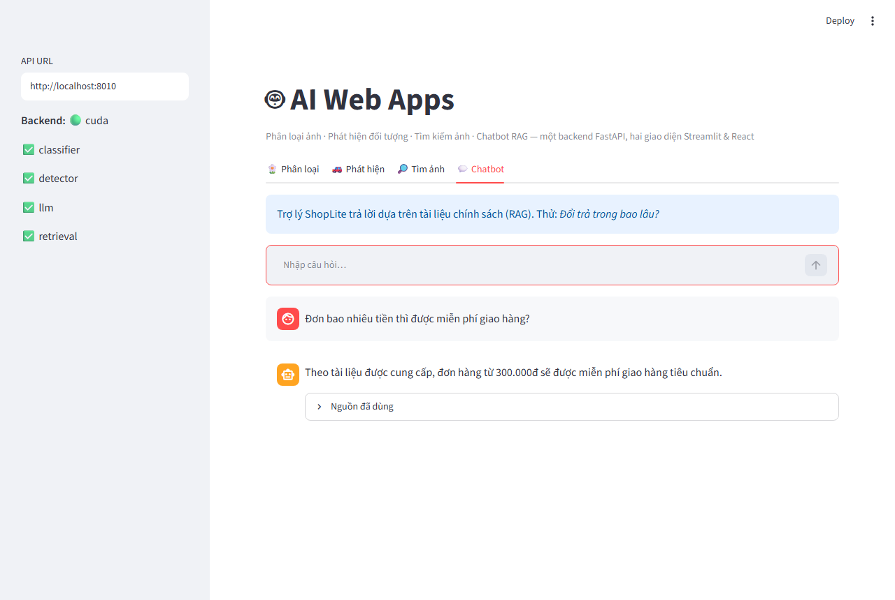

## Cấu trúc
```
config.py              # cấu hình tập trung (biến môi trường)
core/                  # tầng suy luận: classifier, detector, retrieval, llm (RAG)
api/main.py            # FastAPI — một server giữ cả 4 mô hình
streamlit_app.py       # giao diện Streamlit (client mỏng gọi API)
web/                   # giao diện React (Vite), build ra web/dist do FastAPI phục vụ
scripts/s1..s5_*.py    # pipeline dữ liệu → huấn luyện → đánh giá (mục 1–5 notebook)
scripts/smoke_test.py  # kiểm thử khói API đang chạy (mục 6)
tests/test_api.py      # pytest với mô hình giả, không cần GPU
docs/figures/          # hình EDA, ma trận nhầm lẫn, kết quả mẫu
docs/screenshots/      # ảnh chụp giao diện (scripts/screenshots.py)
docs/slides/           # slide thuyết trình: PNG, PDF và mã nguồn (scripts/render_slides.py)
```

## Tái tạo mô hình
```bash
python scripts/s1_data.py         # tải TF Flowers + COCO128, EDA
python scripts/s2_classifier.py   # ResNet-18 fine-tune 5 epoch → artifacts/classifier
python scripts/s3_detector.py     # YOLO11n + mAP trên COCO128 → artifacts/detector
python scripts/s4_retrieval.py    # kho ảnh + chỉ mục CLIP/FAISS → artifacts/retrieval
python scripts/s5_rag.py          # Hit@k truy xuất + hỏi thử LLM → artifacts/rag_metrics.json
```

## Kết quả đo (RTX 3050 Laptop 6 GB, CUDA)
| Ứng dụng | Mô hình | Chỉ số |
|---|---|---|
| 1. Phân loại hoa | ResNet-18 fine-tune (5 epoch) | test accuracy **0,946**, macro-F1 **0,945** (367 ảnh test) |
| 2. Phát hiện đối tượng | YOLO11n pretrained COCO | mAP50 **0,670**, mAP50-95 **0,503** (COCO128) |
| 3. Tìm kiếm ảnh | CLIP ViT-B/32 + FAISS (628 ảnh) | ảnh→ảnh P@5 **0,88**; văn bản→ảnh P@10 **1,0** cả 5 loài |
| 4. Chatbot RAG | MiniLM đa ngôn ngữ + Qwen2.5-1.5B | Hit@1 **1,0**, Hit@3 **1,0** (10 câu) |

Kiểm thử hành vi chatbot (`artifacts/rag_samples.json`): trả lời đúng câu đổi trả; từ chối câu "tiêm lệnh" đòi OTP;
**nhưng** vẫn trả lời câu ngoài phạm vi ("Thủ đô của Pháp") và tính sai phí ship (đơn 200.000đ bị trả lời "0đ",
đúng phải là 25.000đ/35.000đ) — hạn chế của LLM 1,5B, là điểm cần cải thiện ở mục 10.2.

## Chạy trên máy (Python 3.11, Node 22)
Windows: nhấp đúp `start.bat` (mở API cổng 8000 + Streamlit cổng 8501). Hoặc thủ công:
```bash
pip install -r requirements.txt
uvicorn api.main:app --port 8000                  # backend + React build (nếu có web/dist)
API_URL=http://localhost:8000 streamlit run streamlit_app.py
cd web && npm install && npm run dev              # React dev server, proxy /api → 8000
python -m pytest -q tests                         # test không cần GPU
```

## Biến môi trường
| Biến | Mặc định | Ý nghĩa |
|---|---|---|
| `ENABLED_MODELS` | `classifier,detector,retrieval,llm` | Mô hình được nạp |
| `LLM_MODEL` | `Qwen/Qwen2.5-1.5B-Instruct` (GPU) / `-0.5B-` (CPU) | Mô hình sinh |
| `EMBED_MODEL` | `sentence-transformers/paraphrase-multilingual-MiniLM-L12-v2` | Embedding cho RAG |
| `CLIP_MODEL` | `openai/clip-vit-base-patch32` | Tìm kiếm ảnh |
| `CORS_ORIGINS` | `http://localhost:5173,http://localhost:8501` | Origin được gọi API |
| `API_URL` | `http://localhost:8000` | (Streamlit) địa chỉ backend |

## Docker
```bash
docker build -t ai-web-apps . && docker run -p 7860:7860 ai-web-apps   # mở http://localhost:7860
```

Chỉ số mô hình: xem `artifacts/*/metrics.json` và `artifacts/rag_metrics.json`.
